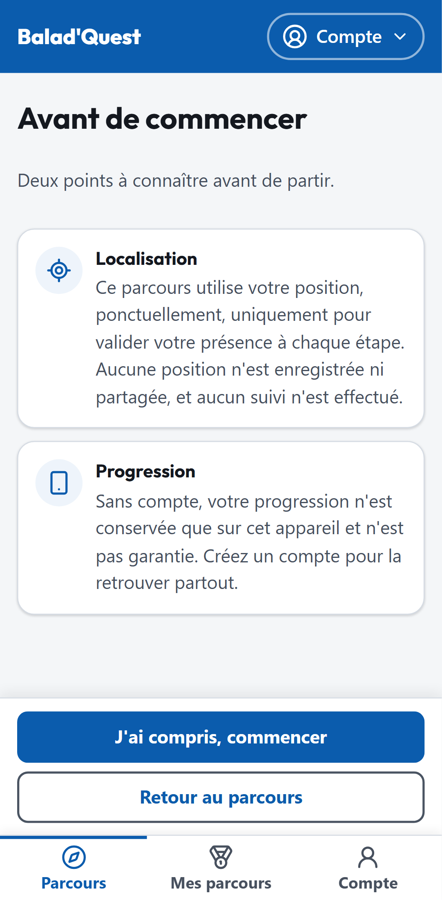
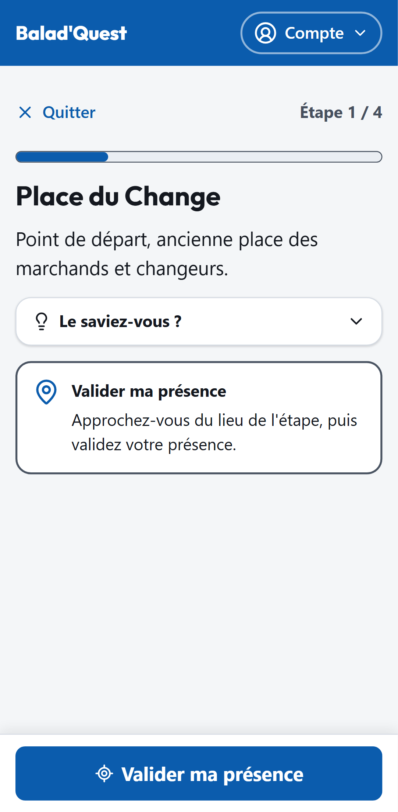

# Faire un parcours

## Commencer

Sur la fiche du parcours, touchez **Commencer le parcours**. Un écran *Avant de commencer* vous présente deux points :

- **Localisation** : votre position sert uniquement, et ponctuellement, à valider votre présence à chaque étape. Aucune position n'est enregistrée ni partagée, et aucun suivi n'est effectué.
- **Progression** : sans compte, votre progression n'est conservée que sur cet appareil. Avec un compte, vous pourrez reprendre plus tard, sur n'importe quel appareil.

Touchez **J'ai compris, commencer** pour arriver à la première étape.

{ .capture .mobile }

## Une étape

Chaque écran d'étape affiche :

- en haut, **Quitter** et votre position dans le parcours (*Étape 1 / 4*), avec une barre de progression ;
- le **titre** et la **description** du lieu ;
- un encart **Le saviez-vous ?** avec des informations historiques ou culturelles, à déplier ;
- le bouton **Valider ma présence**.

{ .capture .mobile }

Une fois sur place, touchez **Valider ma présence** : voir [Valider sa présence](valider-sa-presence.md).

Ensuite, deux cas :

- **Étape standard** : un questionnaire apparaît. Répondez puis touchez **Valider mes réponses**. Voir [Questionnaires](questionnaires.md).
- **Point de passage** (repéré par l'étiquette *Point de passage*) : il n'y a pas de questions, l'étape est terminée dès que votre présence est validée.

Quand l'étape est terminée, l'application passe à l'étape suivante.

## Les étapes se suivent dans l'ordre

Les étapes se débloquent **une par une**. Tant que l'étape en cours n'est pas terminée, la suivante reste verrouillée et affiche :

> Terminez d'abord l'étape précédente pour débloquer celle-ci.

Il n'y a pas de navigation GPS intégrée : la description de chaque étape vous indique où aller.

## Faire une pause et reprendre

Vous pouvez quitter un parcours à tout moment avec **Quitter**.

- **Avec un compte** : retrouvez le parcours dans **Mes parcours**, section *En cours*, et touchez **Reprendre**, depuis n'importe quel appareil. Voir [Mes parcours](../compte/mes-parcours.md).
- **Sans compte** : rouvrez le parcours **sur le même appareil et le même navigateur**. Si vous avez effacé les données du navigateur ou changé d'appareil, la progression est perdue.

!!! note "Parcours abandonné"
    Un parcours commencé puis laissé sans activité pendant longtemps (30 jours par défaut) est considéré comme abandonné. Vous pouvez toujours le recommencer.

## Fin du parcours

Après la dernière étape, l'écran **Parcours terminé !** affiche votre médaille. Voir [Médailles](medailles.md).

## Refaire un parcours

Vous pouvez refaire un parcours déjà terminé. Vous n'obtiendrez pas une seconde médaille, mais votre médaille peut **s'améliorer** si vous faites un meilleur score. Elle ne baisse jamais.
