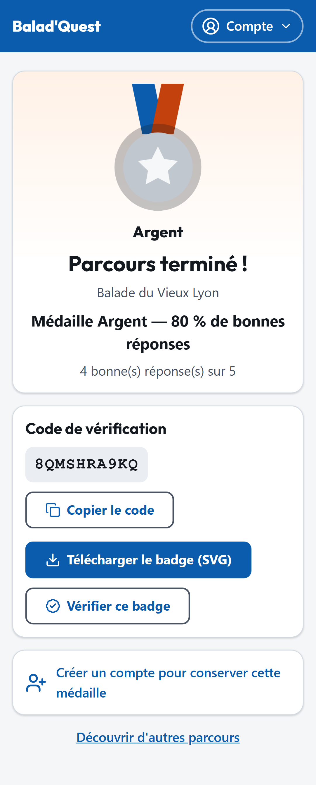
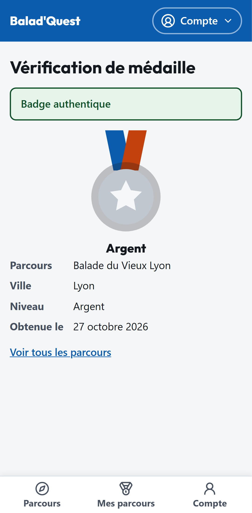

# Médailles

Chaque parcours a son **badge**. En terminant le parcours, vous l'obtenez sous forme de **médaille**, dont le niveau dépend de vos réponses aux questionnaires.

{ .capture .mobile }

## Le barème

| Médaille | Condition |
| --- | --- |
| :material-medal:{ style="color:#d4a017" } **Or** | 100 % de bonnes réponses |
| :material-medal:{ style="color:#9aa4ad" } **Argent** | au moins 66 % de bonnes réponses |
| :material-medal:{ style="color:#b06a2c" } **Bronze** | moins de 66 % |

- Le score porte sur l'ensemble des questions **notées** du parcours (choix unique, choix multiple, vrai/faux). Les réponses libres et les points de passage ne comptent pas.
- Un parcours sans aucune question notée donne directement la médaille **Or**.
- Le temps mis à faire le parcours n'a aucune influence.

## Améliorer sa médaille

Votre médaille est acquise dès la première fois que vous terminez le parcours. Si vous le refaites avec un meilleur score, elle passe au niveau supérieur et l'écran de fin affiche *Nouveau record : votre médaille passe à…*. Une nouvelle tentative ne fait **jamais baisser** votre médaille.

## Sur l'écran de fin

- **Code de vérification** : un code unique qui prouve l'authenticité de votre médaille. **Copier le code** le copie dans le presse-papiers.
- **Télécharger le badge (SVG)** : une image de votre médaille, à garder ou à partager.
- **Vérifier ce badge** : ouvre la page publique de vérification.
- **Créer un compte pour conserver cette médaille** (visiteurs seulement) : voir ci-dessous.

## Vérifier une médaille

Toute personne qui connaît le code de vérification peut confirmer qu'une médaille est authentique. La page de vérification affiche le parcours, la ville, le niveau et la date d'obtention, sans aucune information sur la personne.

{ .capture .mobile }

Si le code est inconnu, la page affiche *Aucune médaille ne correspond à ce code.*

## Visiteur : ne perdez pas votre médaille

Sans compte, votre médaille est liée à votre navigateur. Pour la conserver durablement, créez un compte (ou connectez-vous) **sur le même appareil** : la médaille est alors rattachée à votre compte. Voir [Récupérer une médaille](../compte/recuperer-une-medaille.md).

!!! note "Médaille en attente de connexion"
    Si vous terminez le parcours sans réseau, l'écran affiche *Parcours terminé (en attente de connexion)*. La médaille est confirmée dès le retour du réseau, et la page se met à jour toute seule.
