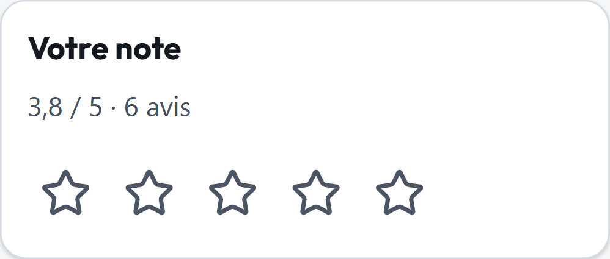
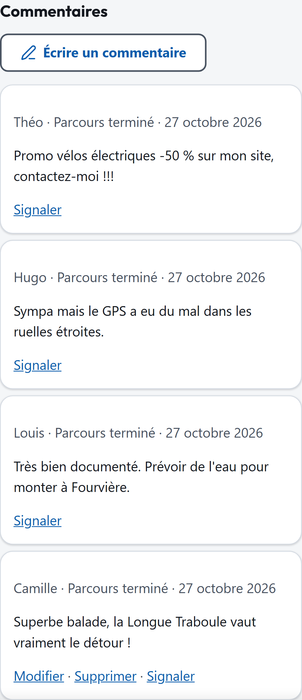
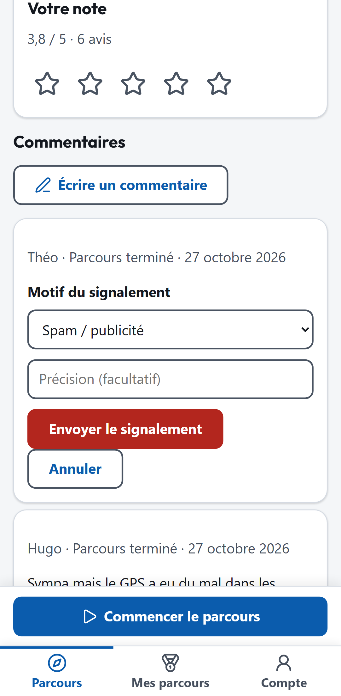

# Notes et commentaires

Sur la fiche d'un parcours, vous pouvez donner votre avis : une **note** de 1 à 5 et un **commentaire**. C'est possible avec ou sans compte, dès que vous avez **commencé** le parcours.

<figure markdown>
{ .capture .mobile }
<figcaption>Attribuer une note</figcaption>
</figure>
<figure markdown>
{ .capture .mobile }
<figcaption>Les commentaires</figcaption>
</figure>

## Noter un parcours

Dans **Votre note**, touchez le nombre d'étoiles souhaité. Vous pouvez changer votre note à tout moment : la nouvelle remplace l'ancienne.

## Commenter

1. Touchez **Écrire un commentaire**.
2. Rédigez votre commentaire (entre 5 et 2 000 caractères).
3. Sans compte, vous pouvez indiquer un **pseudonyme** (sinon vous apparaissez comme « Visiteur »). Avec un compte, votre nom affiché est utilisé.
4. Touchez **Publier**.

Le commentaire est publié **immédiatement**. S'il provient d'un parcours que vous avez terminé, il porte la mention **Parcours terminé**.

Règles à connaître :

- au plus **3 commentaires** par parcours ;
- un délai minimum de **2 minutes** entre deux commentaires ;
- vous pouvez **modifier** votre commentaire pendant **24 heures** après sa publication, et le **supprimer**.

Si une limite est atteinte, l'application affiche *Limite atteinte.* ou *Trop de tentatives. Patientez une minute.*

## Signaler un commentaire

Un commentaire vous paraît inapproprié ? Touchez **Signaler**, choisissez un motif (*Spam / publicité*, *Propos offensants*, *Hors sujet*, *Autre*), ajoutez si besoin une précision, puis **Envoyer le signalement**.

{ .capture .mobile }

Le signalement est transmis aux modérateurs (l'auteur du parcours et les administrateurs), qui décident de conserver, masquer ou supprimer le commentaire.
