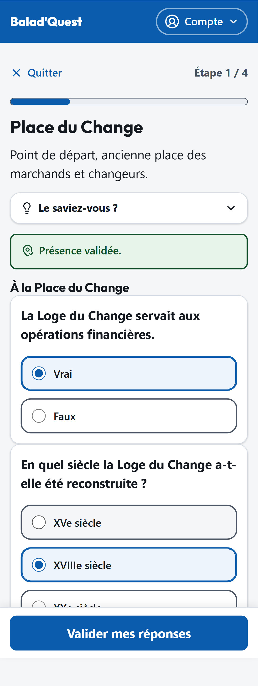
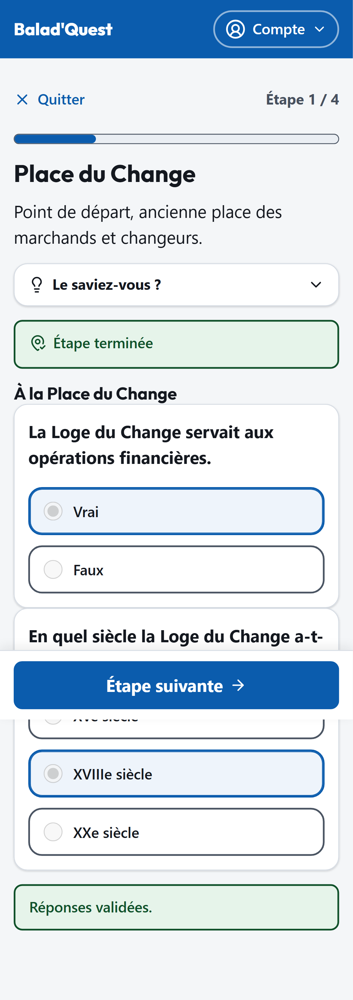

# Questionnaires

Une étape standard propose un petit questionnaire sur le lieu. Il apparaît **après** la validation de votre présence.

<figure markdown>
{ .capture .mobile }
<figcaption>Vos réponses avant validation</figcaption>
</figure>
<figure markdown>
{ .capture .mobile }
<figcaption>La correction, après validation</figcaption>
</figure>

## Types de questions

| Type | Comment répondre | Compte dans le score ? |
| --- | --- | --- |
| **Choix unique** | Sélectionnez une seule proposition. | Oui |
| **Choix multiple** | Sélectionnez **toutes** les bonnes propositions. La réponse n'est juste que si la sélection est exactement la bonne. | Oui |
| **Vrai / Faux** | Choisissez *Vrai* ou *Faux*. | Oui |
| **Réponse libre** | Écrivez votre réponse dans la zone de texte. | Non, il n'y a pas de bonne ou de mauvaise réponse. |

## Répondre et valider

1. Répondez à **toutes** les questions : la validation est impossible tant qu'une question reste sans réponse.
2. Vos réponses sont enregistrées au fur et à mesure : vous pouvez les modifier tant que vous n'avez pas validé.
3. Touchez **Valider mes réponses**.

!!! warning "Les réponses validées sont définitives"
    Une fois le questionnaire validé, vous ne pouvez plus modifier vos réponses pour cette tentative.

## La correction

Après validation, chaque question indique **Bonne réponse** ou **Réponse incorrecte**, parfois avec une explication. Les réponses libres portent la mention *Cette question ne compte pas dans le score*.

Une mauvaise réponse **ne vous bloque jamais** : l'étape est terminée dès que le questionnaire est validé, quelles que soient vos réponses. Votre score sert uniquement à déterminer le niveau de votre [médaille](medailles.md).
