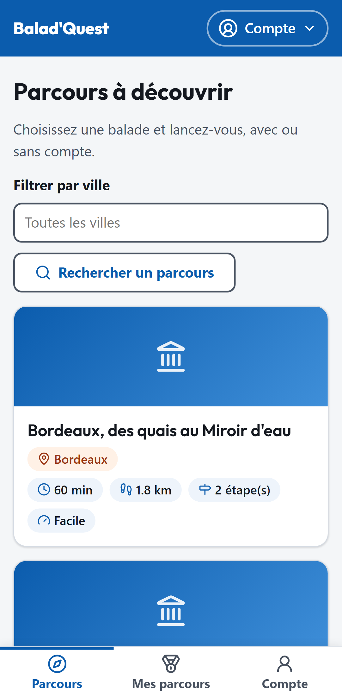
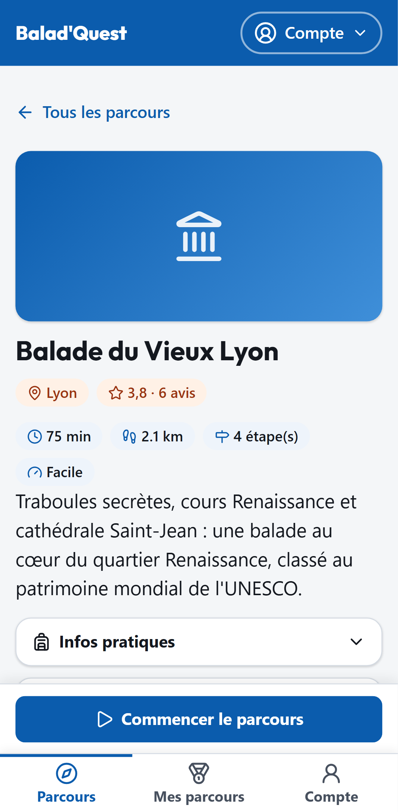
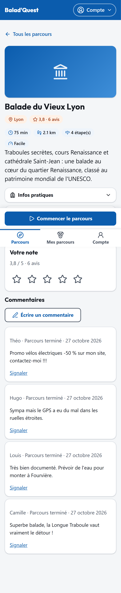
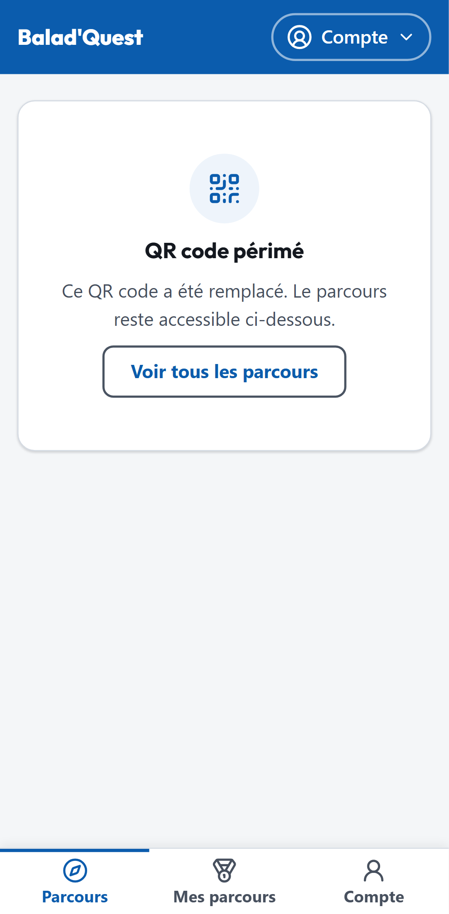

# Trouver un parcours

## Le catalogue

Le menu **Parcours** ouvre le catalogue de tous les parcours publiés. Chaque carte indique la ville, la durée estimée, la distance, la difficulté (*Facile*, *Modéré*, *Difficile*), le nombre d'étapes et la note moyenne.

{ .capture .mobile }

Pour affiner la liste :

- **Rechercher un parcours** : tapez un mot du nom.
- **Filtrer par ville** : choisissez une ville, ou *Toutes les villes*.

Si aucun parcours ne correspond, essayez une autre ville ou retirez le filtre.

## La fiche d'un parcours

Touchez une carte pour ouvrir la fiche du parcours. Vous y trouvez :

- la description, la ville, la durée, la distance et la difficulté ;
- les **informations pratiques** (équipement, accès…) ;
- les **consignes de sécurité** à lire avant de partir ;
- la **récompense** : le badge que vous obtiendrez à la fin ;
- la note moyenne et les commentaires des autres promeneurs.

<figure markdown>
{ .capture .mobile }
<figcaption>Haut de la fiche</figcaption>
</figure>
<figure markdown>
{ .capture .mobile }
<figcaption>Fiche complète, avec avis et commentaires</figcaption>
</figure>

Le bouton **Commencer le parcours** lance la balade : voir [Faire un parcours](faire-un-parcours.md).

## Accéder à un parcours par QR code

Sur le terrain (office de tourisme, affiche, panneau…), un parcours peut être annoncé par un **QR code**. Scannez-le avec l'appareil photo de votre téléphone : la fiche du parcours s'ouvre directement.

Selon la situation, vous pouvez voir l'un de ces messages :

| Message | Signification | Que faire ? |
| --- | --- | --- |
| **QR code périmé** | Ce QR code a été remplacé par un plus récent. Le parcours, lui, existe toujours. | Touchez **Ouvrir le parcours**. |
| **Parcours indisponible** | Le parcours n'est pas publié actuellement. | Revenez plus tard ou choisissez un autre parcours. |
| **Lien invalide** | Le lien ne correspond à aucun parcours. | Vérifiez le QR code, ou passez par le catalogue. |

{ .capture .mobile }
