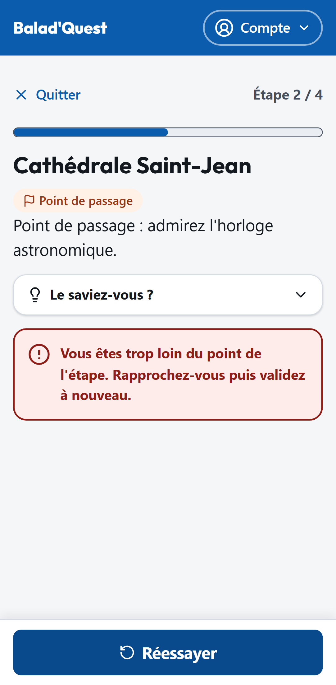

# Valider sa présence

Pour terminer une étape, il faut prouver que vous êtes bien sur place. Quand vous touchez **Valider ma présence**, l'application lit **une seule fois** la position de votre téléphone et vérifie que vous êtes dans la zone de l'étape.

## Comment ça marche

- Chaque étape a une **zone de validation** : un cercle autour du lieu, de 50 mètres de rayon en général (entre 20 et 200 mètres selon l'étape).
- La **précision du GPS** est prise en compte en votre faveur : si le signal est un peu flou, l'application est tolérante.
- En revanche, si le signal est **trop imprécis** (au-delà de 100 mètres par défaut), la validation est refusée et il faut réessayer.
- Votre position n'est **jamais enregistrée** : seul le résultat (« présent » ou non) est conservé.

La première fois, votre navigateur vous demande l'autorisation d'accéder à votre position : acceptez-la.

## Quand ça ne fonctionne pas

| Message | Cause | Que faire ? |
| --- | --- | --- |
| *L'accès à votre position est nécessaire pour valider cette étape…* | Vous avez refusé la localisation. | Autorisez la localisation pour ce site dans les réglages du navigateur, puis touchez **Réessayer**. |
| *Impossible d'obtenir votre position pour le moment…* | Le téléphone ne trouve pas sa position. | Placez-vous à l'air libre, loin des bâtiments hauts, et réessayez. |
| *Le signal GPS est trop imprécis…* | La position est trop approximative. | Patientez quelques instants sans bouger, puis réessayez. |
| *La localisation a pris trop de temps…* | Le GPS a mis trop de temps à répondre. | Patientez, puis réessayez. |
| *Vous êtes trop loin du point de l'étape…* | Vous êtes hors de la zone de l'étape. | Rapprochez-vous du lieu décrit, puis validez à nouveau. |
| *Votre navigateur ne permet pas la géolocalisation.* | Le navigateur ne gère pas la localisation. | Utilisez un navigateur récent (Chrome, Safari, Firefox…). |

{ .capture .mobile }

!!! tip "Réactiver la localisation"
    - **iPhone (Safari)** : Réglages > Confidentialité et sécurité > Service de localisation > Safari > *Lorsque l'app est active*.
    - **Android (Chrome)** : touchez l'icône à gauche de l'adresse du site > Autorisations > Position > *Autoriser*.

## La validation sans GPS

Il arrive que la localisation échoue malgré vos efforts : rue étroite, téléphone capricieux, permission bloquée. Après **3 échecs** ou **10 minutes** d'essais (valeurs par défaut), un bouton **Continuer sans validation GPS** apparaît :

> La validation automatique a échoué plusieurs fois. Vous pouvez continuer : cette étape sera marquée comme visitée sans confirmation GPS.

L'étape est alors considérée comme visitée et vous pouvez poursuivre. Cette option peut être désactivée par l'administrateur de la plateforme : dans ce cas, l'étape reste bloquée jusqu'à une validation réussie sur place.

## Sans réseau

Si vous êtes hors connexion au moment de valider, votre validation est **mise en attente** sur l'appareil et envoyée automatiquement au retour du réseau. Voir [Sans connexion](hors-ligne.md).
