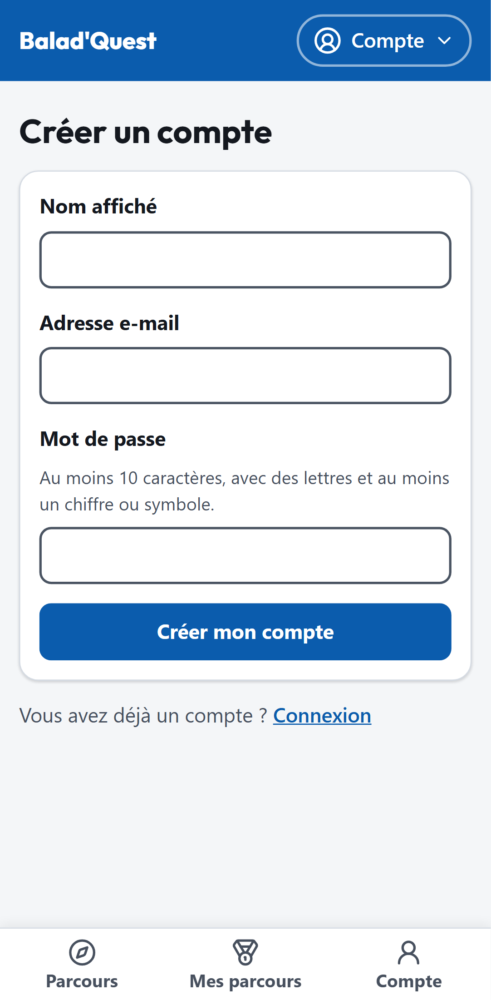
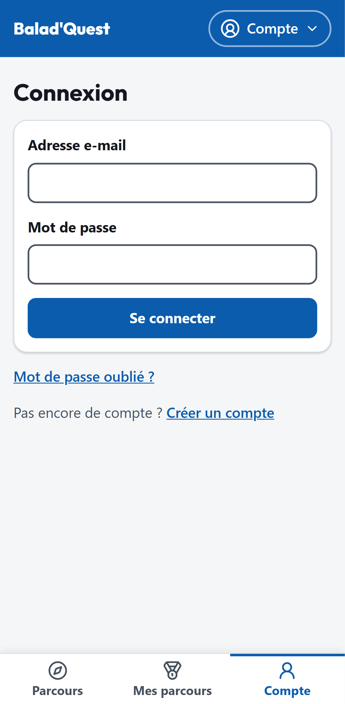

# Créer un compte et se connecter

## Créer un compte

1. Ouvrez le menu **Compte** puis **Créer un compte**.
2. Renseignez votre **nom affiché** (visible dans vos commentaires), votre **adresse e-mail** et un **mot de passe**.
3. Touchez **Créer mon compte**.

Le mot de passe doit contenir **au moins 10 caractères**, avec des lettres et au moins un chiffre ou un symbole.

{ .capture .mobile }

!!! tip "Vous venez de terminer un parcours sans compte ?"
    Créez votre compte **sur le même appareil** : vous pourrez y rattacher la médaille obtenue. Voir [Récupérer une médaille](recuperer-une-medaille.md).

## Se connecter

Menu **Compte** > **Connexion**, puis saisissez votre adresse e-mail et votre mot de passe et touchez **Se connecter**.

{ .capture .mobile }

Votre session reste ouverte sur l'appareil pendant 30 jours. Pour la fermer, utilisez **Se déconnecter** dans le menu **Compte**.

## Mot de passe oublié

1. Sur l'écran de connexion, touchez **Mot de passe oublié ?**.
2. Saisissez votre adresse e-mail et touchez **Envoyer le lien**.
3. Si un compte correspond à cette adresse, vous recevez un e-mail contenant un lien.
4. Ouvrez le lien, choisissez un nouveau mot de passe et touchez **Valider le nouveau mot de passe**.

Si le lien est trop ancien ou déjà utilisé, l'application affiche *Lien de réinitialisation invalide ou expiré* : refaites une demande.

## Messages d'erreur fréquents

| Message | Que faire ? |
| --- | --- |
| *E-mail ou mot de passe incorrect.* | Vérifiez votre saisie, ou utilisez **Mot de passe oublié ?**. |
| *Un compte existe déjà avec cette adresse e-mail.* | Connectez-vous plutôt que de créer un compte. |
| *Mot de passe trop faible…* | Choisissez au moins 10 caractères, mêlant lettres et chiffres ou symboles. |
| *Ce compte est désactivé.* | Contactez l'administrateur de la plateforme. |
| *Trop de tentatives. Patientez une minute.* | Attendez une minute avant de réessayer. |
| *Votre session a expiré. Reconnectez-vous.* | Reconnectez-vous. |
