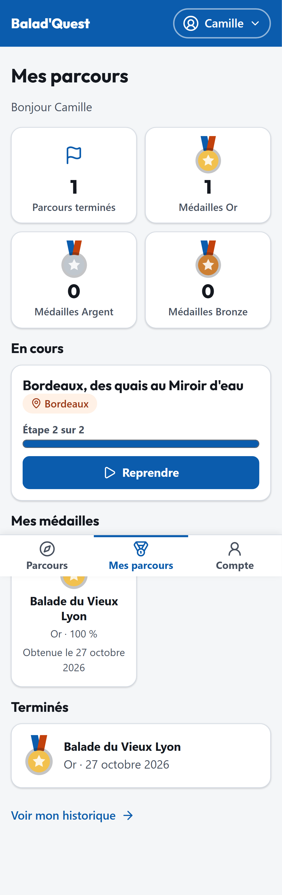
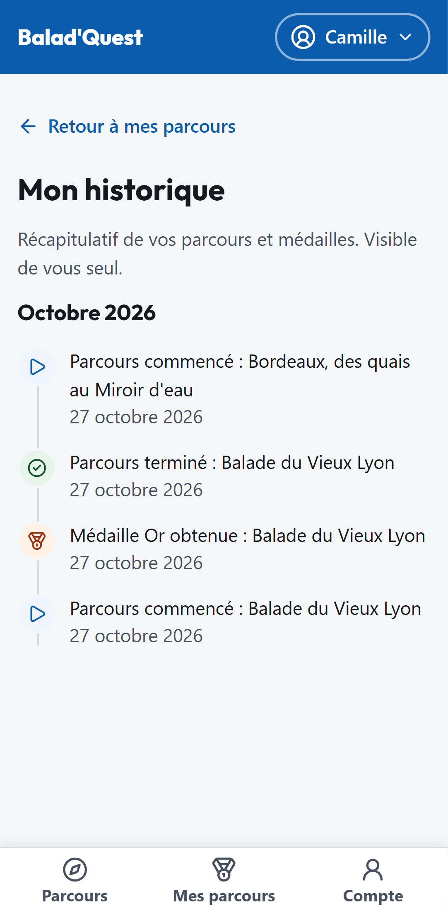

# Mes parcours et mon historique

## Mes parcours

L'onglet **Mes parcours** est votre tableau de bord. Il regroupe :

- **Vos chiffres** : nombre de parcours terminés et de médailles par niveau ;
- **En cours** : les parcours commencés, avec l'étape atteinte (*Étape 2 sur 4*) et un bouton **Reprendre** ;
- **Terminés** : les parcours que vous avez finis ;
- **Mes médailles** : chaque médaille avec son niveau et sa date d'obtention. Touchez-en une pour voir le badge.

{ .capture .mobile }

### Reprendre un parcours

Touchez **Reprendre** sur un parcours en cours : vous revenez directement à l'étape où vous vous étiez arrêté, même si vous avez changé d'appareil. Les étapes déjà terminées restent consultables.

Vous ne pouvez avoir qu'**un seul parcours en cours** pour un même parcours. Recommencer un parcours terminé crée une nouvelle tentative, qui peut [améliorer votre médaille](../balader/medailles.md#ameliorer-sa-medaille).

## Mon historique

Le lien **Voir mon historique** affiche la chronologie de vos balades : parcours commencés, parcours terminés et médailles obtenues. Cet historique n'est visible que par vous.

{ .capture .mobile }
