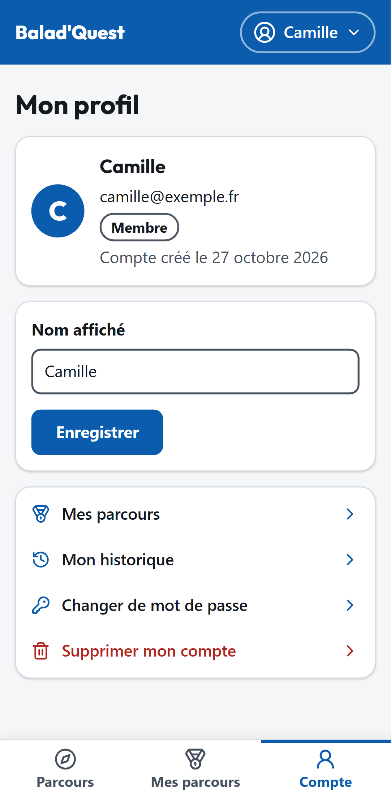

# Profil et mot de passe

## Mon profil

Menu **Compte** > **Mon profil**. Vous y voyez votre nom affiché, votre adresse e-mail, votre rôle (*Membre*, *Contributeur* ou *Administrateur*) et la date de création du compte. Vous pouvez modifier votre **nom affiché** puis **Enregistrer**.

Le profil propose aussi le bouton **Changer de mot de passe** et des **raccourcis** : *Mes parcours*, *Mon historique* et *Supprimer mon compte*.

{ .capture .mobile }

## Changer de mot de passe

1. Depuis le profil, touchez **Changer de mot de passe**.
2. Saisissez votre **mot de passe actuel**, puis le **nouveau mot de passe** deux fois.
3. Touchez **Enregistrer**.

Le nouveau mot de passe doit contenir au moins 10 caractères, avec des lettres et au moins un chiffre ou un symbole.

## Devenir contributeur

Le rôle de contributeur n'est pas accessible en libre-service : il est accordé par un **administrateur** de la plateforme. Une fois le rôle obtenu, le **Studio contributeur** apparaît dans votre menu. Voir [Contribuer](../contribuer/index.md).
