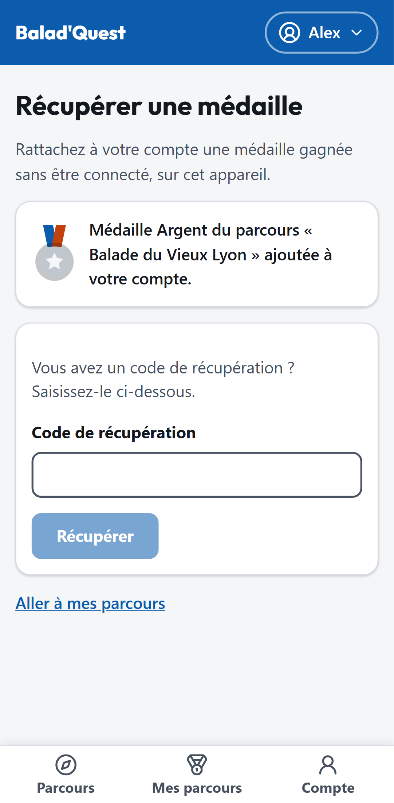

# Récupérer une médaille

Vous avez terminé un parcours **sans être connecté** ? Votre médaille est liée à votre navigateur. Vous pouvez la **rattacher à votre compte** pour la conserver durablement.

## Depuis le même appareil

1. Sur l'écran de fin de parcours, touchez **Créer un compte pour conserver cette médaille**, ou connectez-vous à un compte existant.
2. Dans **Mes parcours**, touchez le lien *Une médaille est en attente de récupération*. La page **Récupérer une médaille** s'ouvre.
3. La récupération est **automatique** : les médailles gagnées sur cet appareil sont ajoutées à votre compte.

{ .capture .mobile }

Le message confirme la médaille ajoutée, par exemple *Médaille Argent du parcours « Balade du Vieux Lyon » ajoutée à votre compte*. Si vous aviez déjà une médaille moins bonne pour ce parcours, elle est améliorée ; elle ne baisse jamais.

## Avec un code de récupération

Si vous disposez d'un **code de récupération**, saisissez-le dans le champ *Code de récupération* puis touchez **Récupérer**.

## En cas de problème

| Message | Signification |
| --- | --- |
| *Aucune médaille en attente sur cet appareil.* | Aucune médaille à récupérer dans ce navigateur. Vérifiez que vous utilisez le même appareil et le même navigateur que pendant le parcours. |
| *Ce code de récupération est inconnu ou a déjà été utilisé.* | Le code est erroné, ou la médaille est déjà rattachée à un compte. |
| *Le délai pour récupérer cette médaille est dépassé.* | La médaille ne peut plus être rattachée. |
| *Cette médaille ne peut pas être rattachée à votre compte.* | La tentative n'est pas récupérable (par exemple, parcours non terminé). |

!!! warning "Ne tardez pas"
    Les tentatives réalisées sans compte ne sont conservées qu'un temps limité (90 jours par défaut). Récupérez votre médaille rapidement.
