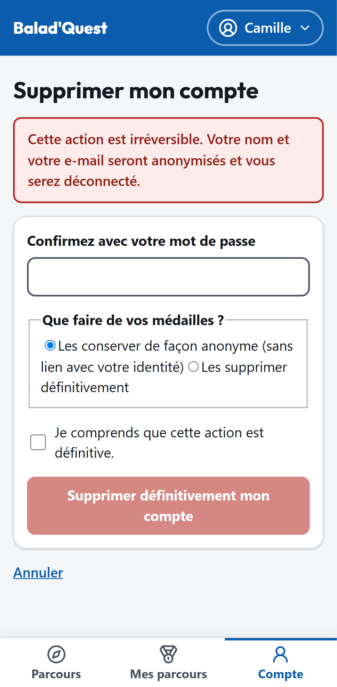

# Vie privée et suppression du compte

## Votre position

- La position n'est lue **qu'au moment où vous touchez *Valider ma présence***, une seule fois.
- Elle sert à calculer si vous êtes dans la zone de l'étape, puis elle est **oubliée** : aucune position n'est enregistrée ni partagée.
- Aucun suivi de vos déplacements n'est effectué.

## Ce qui est conservé

| Donnée | Pourquoi |
| --- | --- |
| E-mail, nom affiché, mot de passe (chiffré) | Faire fonctionner votre compte. |
| Progression, réponses, médailles | Vous permettre de reprendre et de garder vos récompenses. |
| Notes et commentaires | Les afficher sur la fiche du parcours. |

- **Visiteurs sans compte** : la tentative est conservée 90 jours (valeur par défaut), puis supprimée.
- **Statistiques des créateurs de parcours** : elles sont **anonymes** et agrégées. Un créateur ne voit jamais qui a fait son parcours, ni vos réponses libres en clair, ni aucune position.
- Votre adresse e-mail n'est jamais affichée aux autres utilisateurs, ni aux modérateurs.

## Supprimer mon compte

1. Menu **Compte** > **Mon profil** > **Supprimer mon compte**.
2. Confirmez avec votre **mot de passe**.
3. Choisissez ce que deviennent vos médailles :
    - **Les conserver de façon anonyme** (sans lien avec votre identité) ;
    - **Les supprimer définitivement**.
4. Cochez *Je comprends que cette action est définitive.*
5. Touchez **Supprimer définitivement mon compte**.

{ .capture .mobile }

!!! danger "Action irréversible"
    Votre nom et votre e-mail sont anonymisés et vous êtes déconnecté. Le compte ne peut pas être restauré.
