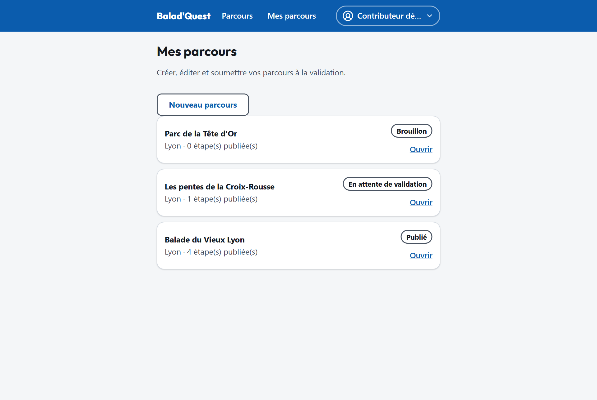
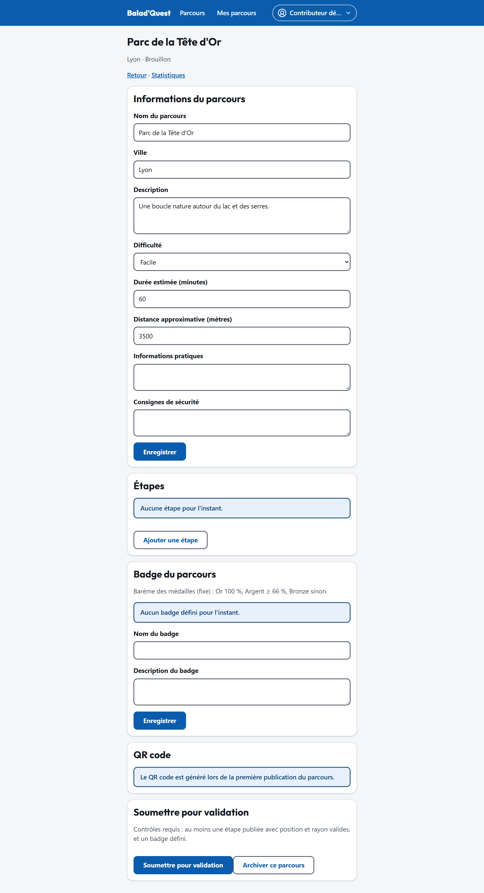

# Créer un parcours

## Le studio

Menu **Compte** > **Studio contributeur**. La page **Mes parcours** liste tous vos parcours avec leur statut et le nombre d'étapes publiées. **Ouvrir** donne accès à l'éditeur d'un parcours.

{ .capture .desktop }

## Nouveau parcours

1. Touchez **Nouveau parcours**.
2. Renseignez les informations du parcours :

    | Champ | Conseil |
    | --- | --- |
    | **Nom du parcours** | Court et évocateur (3 à 120 caractères). |
    | **Ville** | Sert au filtre du catalogue : orthographiez-la toujours de la même façon. |
    | **Description** | Ce que le promeneur va découvrir, l'ambiance, le public visé. |
    | **Difficulté** | *Facile*, *Modéré* ou *Difficile*. Pensez au dénivelé, aux escaliers. |
    | **Durée estimée (minutes)** | Temps de marche et de visite, questionnaires compris. |
    | **Distance approximative (mètres)** | Distance totale à pied. |
    | **Informations pratiques** | Équipement, accessibilité, horaires d'ouverture, points d'eau… (facultatif) |
    | **Consignes de sécurité** | Circulation, passages glissants, respect des riverains… (facultatif) |

3. Enregistrez : le parcours est créé au statut **Brouillon**, et l'éditeur s'ouvre.

## L'éditeur de parcours

L'éditeur regroupe tout le parcours sur une seule page :

- **Informations du parcours** : les champs ci-dessus, avec **Enregistrer** ;
- **Étapes** : voir [Étapes et points de passage](etapes.md) ;
- **Badge du parcours** : voir [Badge et médailles](badge.md) ;
- **QR code** : généré à la première publication, voir [QR code](qr-code.md) ;
- **Soumettre pour validation** : voir [Soumettre et publier](soumettre-et-publier.md).

Le lien **Statistiques**, en haut de page, ouvre les [statistiques](statistiques.md) du parcours.

{ .capture .desktop }
