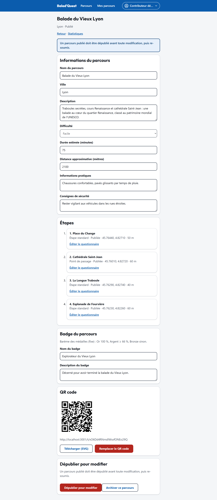

# Étapes et points de passage

Un parcours est une **suite ordonnée d'étapes**. Les promeneurs les suivent strictement dans l'ordre.

## Deux natures d'étapes

| Nature | Questionnaire | Terminée quand… | Usage |
| --- | --- | --- | --- |
| **Étape standard** | Oui, au moins une question | la présence est validée **et** le questionnaire est validé | Lieu à découvrir et à commenter. |
| **Point de passage** | Non | la présence est validée | Halte narrative, panorama, consigne sur place, transition entre deux lieux. |

La nature est **déduite automatiquement** : une étape sans question est un point de passage. Ajouter une question la transforme en étape standard.

## Ajouter une étape

Dans la section **Étapes** de l'éditeur, touchez **Ajouter une étape** et renseignez :

| Champ | Conseil |
| --- | --- |
| **Titre de l'étape** | Le nom du lieu. |
| **Description** | Comment trouver le lieu et quoi y regarder. Il n'y a pas de guidage GPS : soyez précis (« poussez la porte du 54 rue Saint-Jean »). |
| **Contenu historique / culturel** | Affiché dans l'encart *Le saviez-vous ?*. |
| **Latitude** / **Longitude** | Position du point de validation, en degrés décimaux (par exemple 45.7644 et 4.8271). |
| **Rayon de validation (m, 20–200)** | Taille de la zone dans laquelle le promeneur doit se trouver. 50 m par défaut. |

!!! tip "Obtenir les coordonnées d'un lieu"
    Dans un service de cartographie en ligne, un clic droit (ou un appui long sur mobile) sur le lieu affiche ses coordonnées. Copiez-les dans les champs *Latitude* et *Longitude*.

!!! tip "Bien choisir le rayon"
    - **Ruelles étroites, bâtiments hauts** : le GPS y est moins précis, prévoyez 50 à 80 m.
    - **Grand espace dégagé** (esplanade, parc) : 30 à 50 m suffisent.
    - **Étapes proches l'une de l'autre** : évitez que leurs zones se chevauchent trop.

## Organiser les étapes

Chaque étape de la liste propose :

- **Monter** / **Descendre** : changer l'ordre. Les numéros sont recalculés automatiquement ;
- **Modifier** : changer le contenu ou la position ;
- **Publier** / **Dépublier** : seules les étapes **publiées** font partie du parcours joué. Une étape non publiée est ignorée, ce qui permet de préparer une étape sans la rendre visible ;
- **Éditer le questionnaire** : voir [Questionnaires](questionnaires.md) ;
- **Supprimer** : les étapes suivantes sont renumérotées.

Chaque étape affiche sa nature, son état de publication, sa position et son rayon.

{ .capture .desktop }

!!! note
    Modifier la position d'une étape ne remet pas en cause les parcours déjà terminés par les promeneurs.
