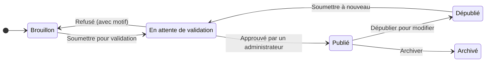

# Contribuer

Les **contributeurs** conçoivent les parcours de Balad'Quest. Depuis le **Studio contributeur**, vous pouvez :

- créer et modifier **vos** parcours : informations, étapes, questionnaires, badge ;
- les **soumettre à validation** : un administrateur les relit avant publication ;
- récupérer le **QR code** de vos parcours publiés ;
- consulter leurs **statistiques anonymes** ;
- **modérer** les commentaires signalés sur vos parcours.

!!! info "Obtenir le rôle de contributeur"
    Le rôle est attribué par un administrateur de la plateforme. Créez d'abord un compte membre, puis demandez le rôle à l'équipe Balad'Quest. Une fois le rôle accordé, le **Studio contributeur** et la **Modération** apparaissent dans votre menu **Compte**.

Le studio est plus confortable sur **ordinateur** ; les captures de cette section ont été prises sur un écran large.

## Le cycle de vie d'un parcours

Un parcours peut aussi être archivé depuis le statut *Brouillon* ou *Dépublié*.

| Statut | Visible dans le catalogue | Modifiable |
| --- | --- | --- |
| **Brouillon** | Non | Oui |
| **En attente de validation** | Non | Non, tant que l'administrateur n'a pas statué |
| **Publié** | Oui, jouable | Non : il faut le dépublier |
| **Dépublié** | Non, plus de nouvelles tentatives | Oui, puis re-soumission |
| **Archivé** | Non | Non, conservé en lecture seule |

## Étapes de création

1. [Créer le parcours](creer-un-parcours.md) et renseigner ses informations.
2. [Ajouter les étapes](etapes.md) : lieux, positions, rayons de validation.
3. [Rédiger les questionnaires](questionnaires.md) des étapes standard.
4. [Définir le badge](badge.md) du parcours.
5. [Soumettre pour validation](soumettre-et-publier.md).
6. Une fois publié : diffuser le [QR code](qr-code.md), suivre les [statistiques](statistiques.md), [modérer](moderation.md) les commentaires.
