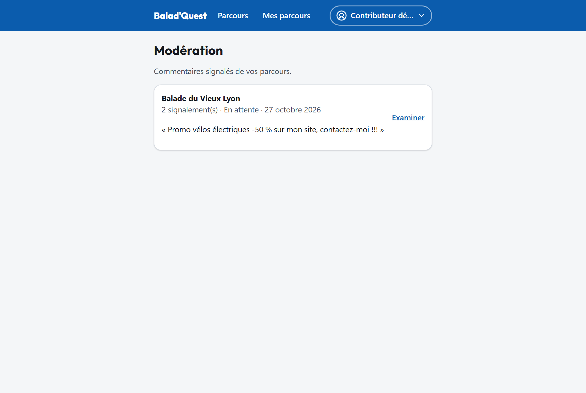
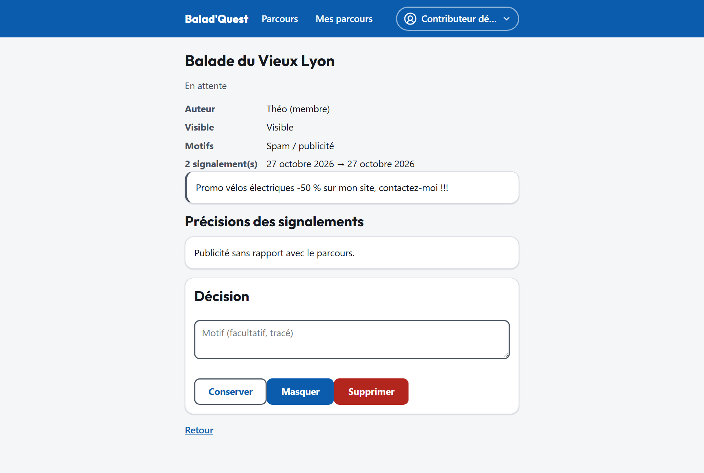

# Modération

Les commentaires sont publiés immédiatement, sans relecture préalable. Quand un promeneur **signale** un commentaire, celui-ci arrive dans la file de **Modération**. En tant que contributeur, vous modérez les commentaires de **vos** parcours ; les administrateurs modèrent ceux de toute la plateforme.

## La file des signalements

Menu **Compte** > **Modération**. Chaque ligne indique le parcours, le nombre de signalements et leur statut (*En attente*, *Conservé*, *Masqué*, *Supprimé*). Plusieurs signalements sur un même commentaire sont regroupés. Touchez **Examiner** pour ouvrir un signalement.

{ .capture .desktop }

## Examiner un signalement

La fiche affiche :

- le **commentaire** signalé et sa visibilité actuelle ;
- son **auteur** : pseudonyme et nature (*membre* ou *visiteur*), sans adresse e-mail ;
- les **motifs** et les **précisions** des signalements.

{ .capture .desktop }

## Décider

Indiquez si vous le souhaitez un **motif** (facultatif, conservé dans l'historique), puis choisissez :

| Décision | Effet |
| --- | --- |
| **Conserver** | Le commentaire reste visible. Le signalement est clos. |
| **Masquer** | Le commentaire disparaît de la fiche publique. Il peut être **ré-affiché** plus tard. |
| **Supprimer** | Le commentaire est retiré définitivement de l'affichage public. |

Chaque décision est horodatée et tracée. L'auteur du commentaire ne reçoit aucune information sur la personne qui a modéré.
