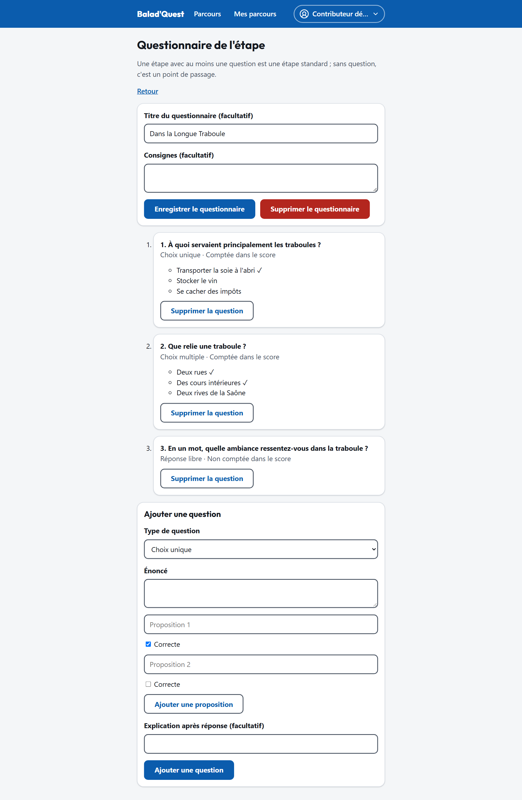

# Questionnaires

Chaque étape peut avoir un questionnaire. Depuis la liste des étapes, touchez **Éditer le questionnaire**.

{ .capture .desktop }

## Le questionnaire

- **Titre du questionnaire** (facultatif) : affiché au-dessus des questions.
- **Consignes** (facultatif) : un mot d'introduction pour le promeneur.
- **Enregistrer le questionnaire** sauvegarde ces deux champs.
- **Supprimer le questionnaire** transforme l'étape en point de passage.

Une étape avec au moins une question est une étape standard ; sans question, c'est un point de passage.

## Ajouter une question

Touchez **Ajouter une question**, choisissez le **type de question**, puis rédigez l'**énoncé** :

| Type | Configuration | Comptée dans le score |
| --- | --- | --- |
| **Choix unique** | Ajoutez des propositions (**Ajouter une proposition**) et cochez **Correcte** pour la bonne. | Oui |
| **Choix multiple** | Ajoutez des propositions et cochez **toutes** les bonnes. Le promeneur doit sélectionner exactement les bonnes propositions : il n'y a pas de points partiels. | Oui |
| **Vrai / Faux** | Indiquez la **Bonne réponse** : *Vrai* ou *Faux*. | Oui |
| **Réponse libre** | Rien à configurer. La réponse n'est jamais notée. | Non |

L'éditeur indique pour chaque question si elle est *Comptée dans le score* ou *Non comptée dans le score*.

Le champ **Explication après réponse** (facultatif) s'affiche au promeneur après validation de ses réponses : profitez-en pour raconter une anecdote ou justifier la bonne réponse.

**Supprimer la question** retire une question ; **Retirer** retire une proposition.

## Bonnes pratiques

- **2 à 4 questions par étape** : le promeneur est debout, en plein air.
- Des questions **auxquelles on répond en observant le lieu** (une date gravée, un détail de façade) plutôt que des questions de culture générale.
- Une **explication** pour chaque question : c'est ce qui rend la correction intéressante.
- Les réponses libres sont utiles pour faire réfléchir, mais n'influencent pas la médaille. Dans vos statistiques, vous ne verrez que leur taux de réponse, jamais leur contenu.
