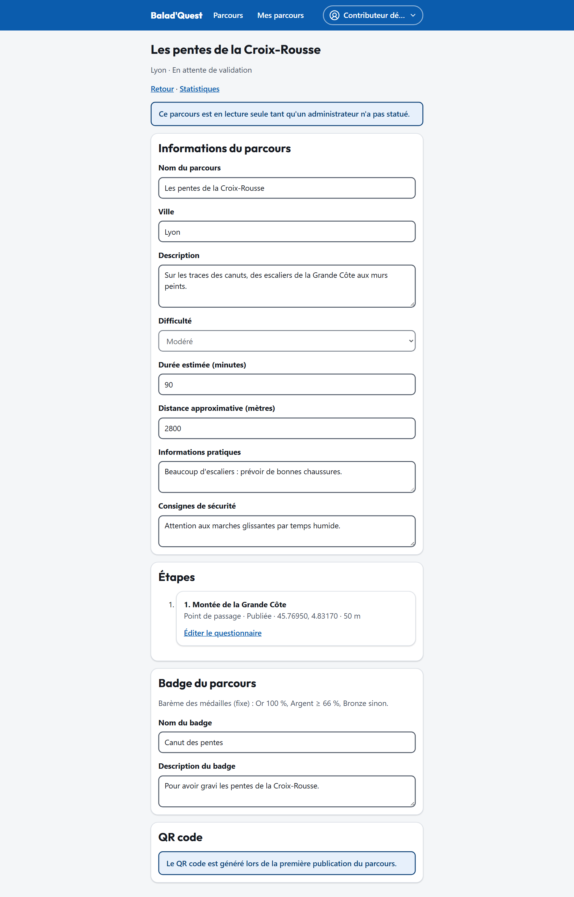

# Soumettre et publier

Un contributeur ne publie pas lui-même ses parcours : chaque parcours est **relu par un administrateur** avant d'entrer dans le catalogue.

## Soumettre pour validation

En bas de l'éditeur, la section **Soumettre pour validation** rappelle les contrôles requis :

- au moins **une étape publiée** ;
- une **position** et un **rayon** valides pour chaque étape ;
- un **badge** défini.

Touchez **Soumettre pour validation**. S'il manque quelque chose, l'application liste les *éléments manquants avant la soumission* (par exemple *au moins une étape publiée*, *un badge de parcours*).

Une fois soumis, le parcours passe au statut **En attente de validation** et devient **en lecture seule** :

> Ce parcours est en lecture seule tant qu'un administrateur n'a pas statué.

{ .capture .desktop }

## La décision de l'administrateur

- **Approuvé** : le parcours passe au statut **Publié**, apparaît dans le catalogue et devient jouable. À la première publication, son [QR code](qr-code.md) est généré.
- **Refusé** : le parcours revient au statut **Brouillon**. Le **motif du refus** s'affiche en haut de l'éditeur. Corrigez puis soumettez à nouveau.

!!! tip "Avant de soumettre"
    Faites le parcours vous-même sur le terrain, ou faites-le tester, pour vérifier les positions, les rayons et la clarté des descriptions.

## Modifier un parcours publié

Un parcours publié ne se modifie pas directement :

1. Touchez **Dépublier pour modifier**. Le parcours sort du catalogue (les nouvelles tentatives ne sont plus possibles).
2. Faites vos modifications.
3. **Soumettez à nouveau** : le parcours repasse par la validation d'un administrateur.

L'historique, les médailles déjà obtenues, les notes, les commentaires, les statistiques et le QR code sont **conservés**.

## Archiver un parcours

**Archiver ce parcours** le retire définitivement : il n'est plus jouable ni modifiable, mais il reste conservé pour l'historique et les statistiques.
