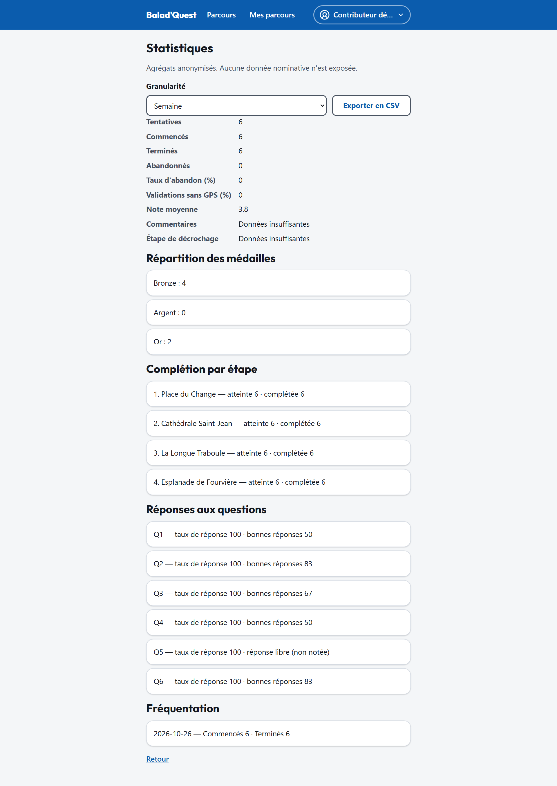

# Statistiques

Depuis l'éditeur d'un parcours, le lien **Statistiques** affiche la fréquentation et les résultats de **votre** parcours.

{ .capture .desktop }

## Les indicateurs

| Indicateur | Signification |
| --- | --- |
| **Tentatives**, **Commencés**, **Terminés**, **Abandonnés** | Nombre de parcours lancés, finis, ou laissés sans activité trop longtemps. |
| **Taux d'abandon (%)** | Part des tentatives abandonnées. |
| **Validations sans GPS (%)** | Part des étapes validées avec *Continuer sans validation GPS*. Un taux élevé sur une étape signale souvent un rayon trop petit ou une position imprécise. |
| **Note moyenne**, **Commentaires** | Avis des promeneurs. |
| **Étape de décrochage** | L'étape où les promeneurs abandonnent le plus. |
| **Répartition des médailles** | Nombre de médailles Bronze, Argent et Or. |
| **Complétion par étape** | Pour chaque étape, combien de promeneurs l'ont atteinte et terminée. |
| **Réponses aux questions** | Pour chaque question : taux de réponse et taux de bonnes réponses. Les réponses libres affichent seulement leur taux de réponse. |
| **Fréquentation** | Évolution des parcours commencés et terminés, par **jour** ou par **semaine** (choix *Granularité*). |

**Exporter en CSV** télécharge ces données pour les retravailler dans un tableur.

## Anonymat

Les statistiques sont **anonymes** et ne permettent jamais de remonter à une personne :

- aucun nom, aucune adresse e-mail, aucune position ;
- les réponses libres ne sont jamais montrées en clair ;
- toute valeur calculée sur **moins de 5 personnes** est masquée et remplacée par *Données insuffisantes*.

Pour un parcours récent, il est donc normal que certaines lignes affichent *Données insuffisantes* : elles apparaîtront quand assez de promeneurs auront fait le parcours.
