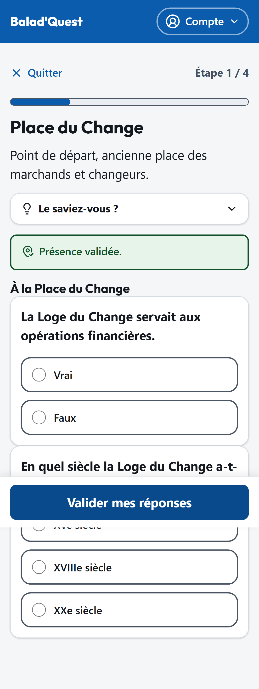

# Bienvenue sur Balad'Quest

Balad'Quest est une application web pour **découvrir une ville à pied**, étape par étape. Chaque parcours est une suite de lieux à rejoindre dans l'ordre : sur place, vous validez votre présence avec la localisation de votre téléphone, vous répondez parfois à quelques questions, et vous gagnez une **médaille** à la fin.

Pas d'application à installer : Balad'Quest s'ouvre dans le navigateur de votre smartphone. Vous pouvez même faire un parcours **sans créer de compte**.

<figure markdown>
{ .capture .mobile }
<figcaption>Le catalogue des parcours</figcaption>
</figure>
<figure markdown>
{ .capture .mobile }
<figcaption>Une étape, après validation de la présence</figcaption>
</figure>
<figure markdown>
{ .capture .mobile }
<figcaption>La médaille de fin de parcours</figcaption>
</figure>

## Par où commencer ?

-   :material-walk: **Je veux me balader**

    ---

    Trouver un parcours, le suivre étape par étape et gagner une médaille, avec ou sans compte.

    [:octicons-arrow-right-24: Se balader](balader/index.md)

-   :material-account: **J'ai (ou je veux) un compte**

    ---

    Conserver sa progression et ses médailles, reprendre un parcours sur un autre appareil.

    [:octicons-arrow-right-24: Mon compte](compte/index.md)

-   :material-pencil-ruler: **Je crée des parcours**

    ---

    Concevoir un parcours dans le studio, le soumettre à validation, suivre ses statistiques.

    [:octicons-arrow-right-24: Contribuer](contribuer/index.md)

-   :material-help-circle: **J'ai une question**

    ---

    Localisation qui ne marche pas, médaille perdue, réseau absent…

    [:octicons-arrow-right-24: FAQ](faq.md)

## Les profils d'utilisateurs

| Profil | Compte | Ce qu'il peut faire |
| --- | --- | --- |
| **Visiteur** | Non | Parcourir le catalogue, faire un parcours, obtenir et télécharger une médaille, noter et commenter. La progression reste sur l'appareil utilisé. |
| **Membre** | Oui | Tout ce que fait le visiteur, avec une progression et des médailles conservées sur son compte, un historique, et la reprise d'un parcours sur n'importe quel appareil. |
| **Contributeur** | Oui, rôle accordé par un administrateur | Créer et gérer **ses** parcours, consulter leurs statistiques anonymes, modérer les commentaires signalés sur ses parcours. |
| **Administrateur** | Oui | Gère la plateforme : comptes, validation des parcours, réglages. |

!!! info "Respect de votre vie privée"
    Votre position est lue **une seule fois**, au moment où vous validez une étape, puis oubliée. Balad'Quest ne suit pas vos déplacements et n'enregistre aucune position. Voir [Vie privée](compte/vie-privee.md).
